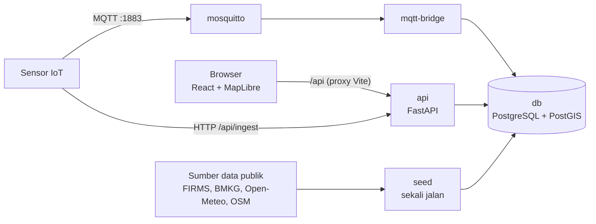

# Arkamap

Arkamap adalah platform pemantauan lingkungan dan kebencanaan Indonesia berbasis peta. Arkamap menggabungkan data publik (titik panas satelit, gempa, kejadian bencana, peringatan cuaca, serta indikator iklim dan kualitas udara untuk 553 wilayah) dengan data sensor IoT milik pengguna, lalu menyajikannya dalam satu peta interaktif, dashboard per profil, dan asisten AI **Jev** yang menjawab pertanyaan berdasarkan data tersebut.

Dibuat oleh tim Ex Machina untuk JOINTS UGM 2026.

## Fitur

- **Peta interaktif publik**: titik panas (NASA FIRMS), gempa, kejadian bencana, peringatan BMKG, choropleth indikator per provinsi, arah angin, dan jejak bangunan saat zoom dekat. Bisa dipakai tanpa akun.
- **Akun dan profil**: daftar/masuk, hingga tiga profil pantauan (peran, tujuan, wilayah) dengan mode Protected (tanggap darurat), Responden (pencegahan), atau Plan (perencanaan) yang menentukan isi dashboard.
- **Dashboard**: indikator wilayah, prioritas wilayah, riwayat kejadian, prakiraan, dan widget sensor.
- **Sensor IoT sendiri (BYOD)**: daftarkan alat, terima API key sekali tampil beserta contoh kode (curl, Python, MQTT, ESP32), lalu kirim data lewat HTTP atau MQTT. Field sensor dikenali otomatis menjadi tabel data dan widget.
- **Jev**: asisten AI dengan jawaban streaming yang mengutip data dari backend.

## Arsitektur



Browser hanya memanggil `/api` di origin frontend; proxy meneruskannya ke API, sehingga tidak butuh CORS dan app key tidak pernah sampai ke browser. Login memakai JWT Bearer; sensor memakai API key per perangkat.

## Struktur repo

```
arkamap/
├── frontend/            React + TypeScript + Vite (UI, peta, dashboard, chat Jev)
├── backend/             FastAPI + PostGIS (API, ingest data publik, IoT, agen Jev)
├── docs/                Kontrak API, arsitektur frontend, design system, integrasi
├── mosquitto/           Konfigurasi broker MQTT
├── scripts/             Setup database lokal tanpa Docker (Windows)
└── docker-compose.yml   Backend, database, dan broker dalam satu perintah
```

Kontrak API (`docs/backend/openapi.json`) dibuat dari kode backend; tipe TypeScript frontend dibuat dari kontrak itu, dan CI menolak perubahan yang membuat keduanya berbeda. Ringkasan endpoint per fitur ada di [docs/API_CONTRACT.md](docs/API_CONTRACT.md).

## Menjalankan

Butuh Docker dengan Compose v2 dan Node 24. Dari root repo:

```bash
docker compose up --build -d          # db, mosquitto, api, mqtt-bridge, seed
cd frontend
npm ci
ARKAMAP_API_TARGET=http://127.0.0.1:8000 npm run dev
```

| Alamat | Isi |
| --- | --- |
| http://127.0.0.1:5174 | Aplikasi web (Vite meneruskan `/api` ke API) |
| http://127.0.0.1:8000/docs | Dokumentasi API interaktif (Swagger) |
| `localhost:1883` | MQTT untuk sensor (login `dev<id>` + API key perangkat) |

`ARKAMAP_API_TARGET` bisa juga ditulis sekali di `frontend/.env.local`. Daftar akun lewat **Sign up**, lalu tambah sensor di **Perangkat IoT & BYOD → Tambah Alat**. Service `seed` mengunduh data publik ke database kosong pada start pertama (beberapa menit, butuh internet); aplikasi sudah bisa dipakai selama proses ini.

Konfigurasi opsional dibaca dari `.env` di root repo (contoh di [.env.example](.env.example)): `GEMINI_API_KEY`, `OPENROUTER_API_KEY`, dan `DEEPSEEK_API_KEY` mengaktifkan LLM untuk Jev (tanpa itu Jev menjawab dari template). Nilai default compose hanya untuk evaluasi lokal; isi `POSTGRES_PASSWORD`, `JWT_SECRET`, dan `MQTT_BRIDGE_PASSWORD` sebelum dibuka ke publik. Hapus data: `docker compose down -v`.

Chat Jev versi Chainlit untuk uji internal: `docker compose --profile chat up chat`, lalu buka http://127.0.0.1:8001.

## Pengembangan

**API hosted.** Tanpa backend lokal, buat `frontend/.env.hosted.local` berisi `ARKAMAP_API_TARGET` (origin API) dan `ARKAMAP_API_KEY`, lalu `npm run dev:hosted`. Proxy Vite menambahkan app key di sisi server.

**Backend tanpa Docker** (Python 3.13, PostgreSQL 14+ dengan PostGIS). Di Windows, skrip membuat cluster khusus di `.runtime/postgres` port `55432` serta `.env.local` dengan secret acak; di Linux/macOS buat `.env.local` dari `.env.example`:

```powershell
python -m venv .venv
.venv\Scripts\python.exe -m pip install -r backend/requirements-dev.txt
powershell -NoProfile -ExecutionPolicy Bypass -File scripts/init-local.ps1
.venv\Scripts\python.exe -m uvicorn app.main:app --app-dir backend --env-file .env.local --port 8000
```

Registrasi perangkat membutuhkan broker MQTT: `docker compose up -d mosquitto`.

## Pengujian

```bash
# backend (dari root)
python backend/test_iot.py && python backend/test_agent.py && python backend/test_bmkg.py

# frontend (dari frontend/)
npm run check               # lint, typecheck, batas arsitektur, katalog komponen
npm run build
npm run test:api            # klien API dan stream Jev
npm run api:check           # kontrak OpenAPI dan tipe TypeScript sesuai backend
```

`backend/test_atlas.py` dan `backend/test_fire.py` membutuhkan database berisi data. Alur kerja dan pemeriksaan sebelum PR ada di [CONTRIBUTING.md](CONTRIBUTING.md).

## Batasan

- Tidak ada data yang tersimpan saat install; dataset publik masuk lewat `seed` dan penjadwal backend, dan tile peta membutuhkan internet.
- Login berlaku per tab browser (JWT di sessionStorage tab): tetap masuk saat reload, tetapi tab baru memerlukan login ulang.
- Backend hanya menyimpan nama, jenis, dan lokasi perangkat; isian formulir lain (pemilik, alamat, baterai) tampil dengan nilai default.
- Simulator, forensik, dan disposisi masih berupa Preview.

## Dokumentasi

- [Kontrak API](docs/API_CONTRACT.md) dan [catatan integrasi](docs/integration/README.md): [matriks endpoint](docs/integration/API_ENDPOINT_MATRIX.md), [audit kontrak](docs/integration/API_CONTRACT_AUDIT.md), [validasi](docs/integration/VALIDATION.md)
- Backend: [panduan API](docs/backend/API.md), [akun dan perangkat IoT](docs/backend/IOT.md), [halaman frontend per endpoint](docs/backend/FRONTEND.md), [komponen agen](docs/backend/VIZ.md), [infrastruktur dan keamanan](docs/backend/Infra.md)
- [Frontend](docs/frontend/README.md): [arsitektur](docs/frontend/ARCHITECTURE.md), [design system](docs/frontend/DESIGN-SYSTEM.md), [katalog komponen](docs/frontend/COMPONENTS.md), [checklist UI](docs/frontend/UI-CHECKLIST.md)
- [Aturan visual](DESIGN.md) dan [panduan kontribusi](CONTRIBUTING.md)

## Lisensi

[MIT](LICENSE) © 2026 Ex Machina. Komponen turunan BoardUI memakai [lisensinya sendiri](frontend/LICENSE.boardui).
