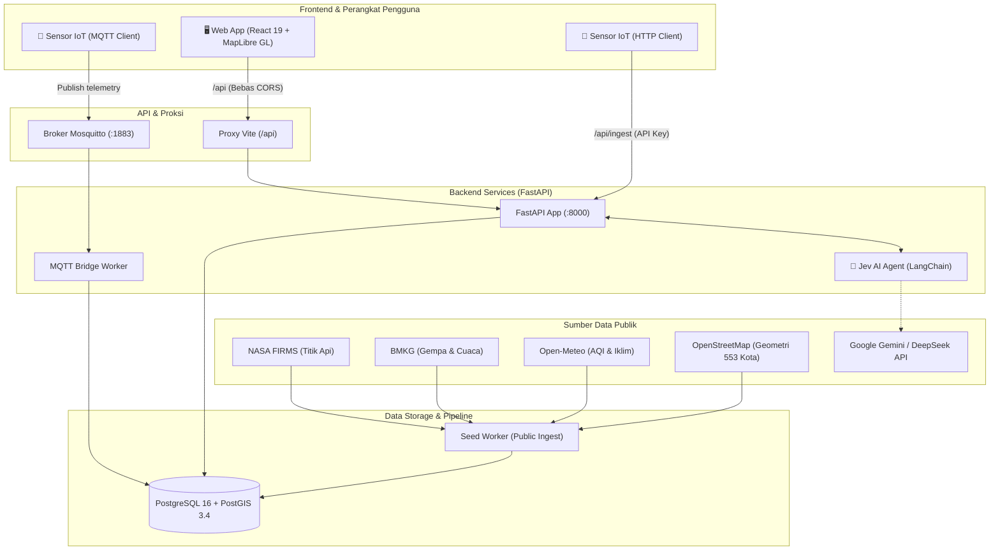
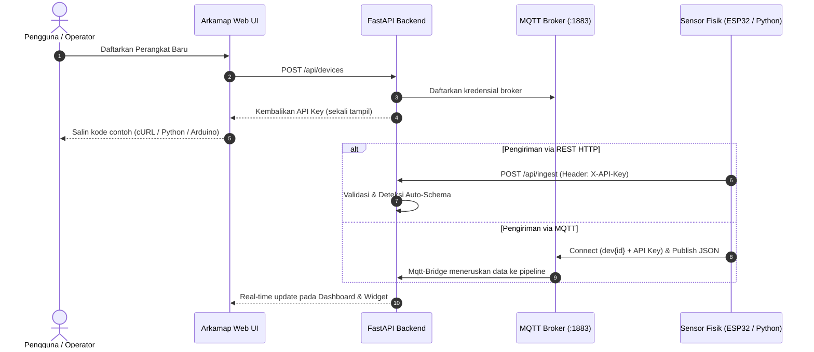

<p align="center">
  
</p>

<h1 align="center">Arkamap</h1>

<p align="center">
  <strong>Platform Intelijen Lingkungan, Kebencanaan, dan Geospasial Indonesia Berbasis AI & IoT</strong>
</p>

<p align="center">
  <em>Dibuat oleh Tim <b>Ex Machina</b> untuk kompetisi <b>JOINTS UGM 2026</b></em>
</p>

<p align="center">
  <a href="https://github.com/ex-machina-org/arkamap/actions/workflows/frontend.yml"></a>
  <a href="https://github.com/ex-machina-org/arkamap/actions/workflows/integration.yml"></a>
  
  
  
  
  
  <a href="LICENSE"></a>
</p>

<p align="center">
  <a href="#-tentang-arkamap">Tentang</a> •
  <a href="#-fitur-unggulan">Fitur Unggulan</a> •
  <a href="#-arsitektur-sistem">Arsitektur</a> •
  <a href="#-struktur-repositori">Struktur Repositori</a> •
  <a href="#-memulai-cepat-quickstart">Quickstart</a> •
  <a href="#-integrasi-sensor-iot-byod">Sensor IoT (BYOD)</a> •
  <a href="#-asisten-ai-jev">Asisten Jev</a> •
  <a href="#-pengujian--kualitas-kode">Pengujian</a> •
  <a href="#-dokumentasi">Dokumentasi</a>
</p>

---

## 🌿 Tentang Arkamap

Indonesia merupakan negara kepulauan yang rentan terhadap dinamika iklim ekstrem dan bencana alam berkala—mulai dari titik api kebakaran hutan, gempa tektonik aktif, polusi udara perkotaan, hingga anomali cuaca di lebih dari **553 kabupaten dan kota**. Seringkali, data ini tersebar di berbagai portal terpisah dan sulit diakses secara kontekstual oleh masyarakat maupun petugas lapangan.

**Arkamap** hadir sebagai platform geospasial terpadu yang memadukan data publik berskala nasional (satelit NASA FIRMS, sensor seismik & peringatan BMKG, Open-Meteo, dan OpenStreetMap) dengan **telemetri sensor IoT mandiri (BYOD)** milik pengguna. Seluruh informasi dirangkum dalam satu peta interaktif multi-layer, dashboard analitik berbasis persona, serta didampingi oleh **Jev**, asisten kecerdasan buatan (AI) yang mampu menganalisis risiko dan menjawab pertanyaan kebencanaan secara real-time dengan referensi data faktual backend.

---

## ✨ Fitur Unggulan

<table width="100%">
  <tr>
    <td width="50%" valign="top">
      <h3>🗺️ Peta Geospasial Publik</h3>
      <ul>
        <li><b>Titik Panas Satelit:</b> Deteksi titik api aktif dari instrumen NASA FIRMS (MODIS & VIIRS) harian.</li>
        <li><b>Gempa Terkini & Dirasakan:</b> Peringatan gempa M &ge; 5.0 dan gempa dirasakan langsung dari BMKG.</li>
        <li><b>Choropleth 553 Wilayah:</b> Visualisasi gradasi indikator cuaca, iklim, curah hujan, dan indeks kualitas udara (AQI).</li>
        <li><b>Dinamika Angin & Jejak 3D:</b> Aliran partikel arah angin dan jejak 3D bangunan OpenStreetMap pada zoom dekat.</li>
        <li><b>Akses Tanpa Akun:</b> Siapapun dapat langsung memantau situasi kebencanaan tanpa hambatan autentikasi.</li>
      </ul>
    </td>
    <td width="50%" valign="top">
      <h3>🛡️ Dashboard Berbasis Persona</h3>
      <ul>
        <li><b>Protected Mode:</b> Fokus tanggap darurat, peringatan dini bahaya di sekitar, panduan keselamatan, dan radius evakuasi.</li>
        <li><b>Responden Mode:</b> Penanganan di lapangan, pemetaan prioritas wilayah terdampak, serta pelacakan kesiapan alat.</li>
        <li><b>Plan Mode:</b> Perencanaan jangka panjang, tren historis indikator lingkungan, dan formulasi kebijakan mitigasi.</li>
        <li><b>Multi-Profil:</b> Satu akun dapat memiliki hingga 3 profil pantauan dengan konfigurasi wilayah spesifik.</li>
      </ul>
    </td>
  </tr>
  <tr>
    <td width="50%" valign="top">
      <h3>📡 Bring Your Own Device (BYOD) IoT</h3>
      <ul>
        <li><b>Dual Ingestion:</b> Kirim telemetri perangkat lewat REST API (<code>/api/ingest</code>) atau broker <b>MQTT</b> (port 1883).</li>
        <li><b>Onboarding 1-Klik:</b> Hasilkan API key sekali tampil lengkap dengan contoh kode instan (cURL, Python, MQTT, ESP32).</li>
        <li><b>Dynamic Schema Engine:</b> Field telemetri baru otomatis dikenali dan langsung dirender menjadi tabel serta widget interaktif.</li>
      </ul>
    </td>
    <td width="50%" valign="top">
      <h3>🤖 Asisten Lingkungan AI (Jev)</h3>
      <ul>
        <li><b>Context-Grounded:</b> Jawaban streaming real-time yang langsung mengutip data agregasi spasial backend.</li>
        <li><b>Multi-Provider LLM:</b> Kompatibel dengan Google Gemini 2.5 Flash, OpenRouter, dan DeepSeek.</li>
        <li><b>Offline Fallback:</b> Tetap responsif menggunakan template cerdas terstruktur bila kunci API LLM tidak dikonfigurasi.</li>
      </ul>
    </td>
  </tr>
</table>

---

## 🏗️ Arsitektur Sistem

Arkamap dirancang dengan arsitektur modular yang memisahkan frontend, backend analitik spasial, antrean pesan MQTT, dan penyimpanan PostGIS performa tinggi:



> [!NOTE]
> **Keamanan & Isolasi Origin**: Browser klien hanya berinteraksi lewat rute `/api` di origin frontend; Vite proxy meneruskannya langsung ke API internal backend. Dengan skema ini, backend tidak memerlukan header CORS yang berisiko, dan application key internal tidak pernah terekspos ke sisi klien. Login menggunakan JWT Bearer yang tersimpan aman di `sessionStorage`, sedangkan tiap perangkat IoT diotentikasi menggunakan API key unik tersendiri.

---

## 📂 Struktur Repositori

```text
arkamap/
├── frontend/                # Antarmuka web (React 19, TypeScript, Vite, Tailwind v4, MapLibre GL)
│   ├── src/                 # Komponen UI, peta interaktif, panel analitik, dan chat Jev
│   ├── public/              # Aset brand, ikon visual, dan sprite peta
│   └── scripts/             # Pengecekan batas arsitektur & generator tipe OpenAPI
├── backend/                 # API Server & Komputasi Spasial (FastAPI, PostGIS, LangChain)
│   ├── app/                 # Modul API, ingestion data publik, logika IoT, & agen Jev
│   ├── seed.py              # Skrip unduh dataset publik awal (FIRMS, BMKG, Open-Meteo)
│   └── seed_iot_demo.py     # Demo generator untuk akun pengujian dan data telemetri IoT
├── docs/                    # Kontrak API, standar desain UI, & panduan integrasi
│   ├── API_CONTRACT.md      # Rangkuman endpoint dan skema payload per modul
│   ├── frontend/            # Arsitektur UI, katalog komponen, dan checklist UX
│   ├── backend/             # Spesifikasi infrastruktur, IoT, dan panduan API
│   └── assets/              # Aset visual dan banner repositori
├── mosquitto/               # Konfigurasi broker MQTT (otentikasi dinamis per-perangkat)
├── scripts/                 # Otomasi setup database lokal tanpa kontainer (PowerShell)
├── docker-compose.yml       # Orkestrasi kontainer terpadu (API, DB, Broker, Bridge, Seed)
└── CONTRIBUTING.md          # Panduan kontribusi, alur pull request, dan standar kode
```

> [!TIP]
> Kontrak API (`docs/backend/openapi.json`) diekspor langsung dari kode FastAPI backend. Tipe data TypeScript frontend di-*generate* secara deterministik dari kontrak tersebut, dan sistem CI akan menolak pull request apabila ada ketidaksesuaian kontrak antara backend dan frontend.

---

## ⚡ Memulai Cepat (Quickstart)

### Prasyarat
- **Docker** dengan **Compose v2**
- **Node.js** versi `22.12+` atau `24`

### 1. Menjalankan Seluruh Ekosistem dengan Docker

Jalankan seluruh service (Database PostGIS, Mosquitto Broker, API, MQTT Bridge, Seed Data, dan aplikasi web) dengan satu perintah:

```bash
# Dari root repositori
docker compose up --build -d
```

Lalu buka [http://localhost:8080](http://localhost:8080). Service `web` menyajikan build frontend dan meneruskan `/api` (termasuk MQTT WebSocket `ws://localhost:8080/api/mqtt`) ke backend di alamat yang sama, seperti di VPS. Untuk database kosong tanpa mengunduh data publik, lewati `seed`: `docker compose up --build -d web` (db, broker, dan API ikut naik sebagai dependensi).

### 2. Menjalankan Frontend Development Server (opsional)

Untuk mengubah tampilan dengan hot reload, jalankan dev server di terminal baru:

```bash
cd frontend
npm ci
ARKAMAP_API_TARGET=http://127.0.0.1:8000 npm run dev
```

*(Catatan: Anda juga dapat mendefinisikan `ARKAMAP_API_TARGET=http://127.0.0.1:8000` di dalam file `frontend/.env.local`).*

---

### 🌐 Port & Endpoint Service

| Service | Alamat URL / Port | Keterangan |
| :--- | :--- | :--- |
| **Aplikasi Web (Docker)** | [http://localhost:8080](http://localhost:8080) | Build frontend + `/api` di satu alamat (service `web`) |
| **Aplikasi Web (dev server)** | [http://127.0.0.1:5174](http://127.0.0.1:5174) | `npm run dev` dengan hot reload |
| **Dokumentasi API (Swagger)** | [http://127.0.0.1:8000/docs](http://127.0.0.1:8000/docs) | OpenAPI interactive explorer & testing endpoint |
| **MQTT Broker (Mosquitto)** | `localhost:1883` | Saluran ingest sensor IoT (User: `dev<id>`, Password: API key) |
| **Jev AI Internal Evaluator** | [http://127.0.0.1:8001](http://127.0.0.1:8001) | Chainlit UI untuk observabilitas agen (`--profile chat`) |

---

### 🧪 Data Contoh & Telemetri Demo

1. **Unduh Data Publik Pertama Kali:** Service `seed` akan otomatis mengunduh dataset nasional pada peluncuran pertama kontainer ke dalam database PostGIS yang kosong. Aplikasi sudah langsung dapat digunakan selama proses ini berlangsung di latar belakang.
2. **Akun & Perangkat Uji IoT:** Untuk mencoba dashboard multi-versi sensor seketika tanpa alat fisik:
   ```bash
   docker compose exec api python seed_iot_demo.py
   ```
   *Skrip ini akan membuat akun `uji.versi@arkamap.local` dengan perangkat yang memancarkan telemetri sensor cuaca dan kualitas udara secara otomatis.*
3. **Mencoba Chat Agen Jev secara Mandiri:**
   ```bash
   docker compose --profile chat up chat
   # Buka http://127.0.0.1:8001 pada peramban Anda
   ```

---

## 📡 Integrasi Sensor IoT (BYOD)

Arkamap memberikan kebebasan kepada pengguna, komunitas, dan institusi untuk menghubungkan stasiun cuaca atau sensor lingkungan pribadi (**Bring Your Own Device**).



### Contoh Pengiriman Data Telemetri via cURL

```bash
curl -X POST "http://127.0.0.1:8000/api/ingest" \
  -H "Content-Type: application/json" \
  -H "X-API-Key: <DEVICE_API_KEY>" \
  -d '{
    "suhu": 28.4,
    "kelembaban": 72.1,
    "pm25": 18.5,
    "curah_hujan_mm": 2.0
  }'
```

Setiap metrik baru yang dikirimkan akan langsung diidentifikasi secara otomatis menjadi kolom tabel historis dan widget analitik pada dashboard profil Anda.

---

## 🤖 Asisten AI: Jev

**Jev** bukan sekadar chatbot umum, melainkan agen kecerdasan lingkungan yang terintegrasi langsung dengan database geospasial Arkamap:

- 🔍 **Analisis Tergrounding Data**: Mampu menjawab pertanyaan seperti *"Bagaimana tren titik panas di Kalimantan Barat 3 hari terakhir?"* atau *"Apakah ada peringatan cuaca ekstrem BMKG untuk area tempat tinggal saya hari ini?"*.
- ⚡ **Streaming Respon**: Menghasilkan respon cepat dengan visualisasi referensi data langsung di antarmuka.
- 🔑 **Multi-Model Provider**: Cukup sediakan API key pada `.env` di root repositori:
  ```env
  GEMINI_API_KEY="your-gemini-api-key"
  # Opsional alternatif:
  # OPENROUTER_API_KEY="your-openrouter-key"
  # DEEPSEEK_API_KEY="your-deepseek-key"
  ```
  *Bila kunci API tidak diisi, Jev tetap berfungsi dalam mode demonstrasi offline menggunakan basis pengetahuan template kontekstual.*

---

## 🛠️ Pengembangan Lokal (Local Development)

### Mode 1: Frontend Terhubung ke Hosted API
Bila ingin mengembangkan antarmuka tanpa menyalakan backend lokal, buat file `frontend/.env.hosted.local`:
```env
ARKAMAP_API_TARGET=https://api.arkamap.example.com
ARKAMAP_API_KEY=your-app-key
```
Lalu jalankan server frontend:
```bash
npm run dev:hosted
```

### Mode 2: Backend Lokal Tanpa Docker (Windows PowerShell)
Dibutuhkan Python 3.13 dan PostgreSQL 14+ dengan ekstensi PostGIS:

```powershell
python -m venv .venv
.\.venv\Scripts\python.exe -m pip install -r backend/requirements-dev.txt
powershell -NoProfile -ExecutionPolicy Bypass -File scripts/init-local.ps1
.\.venv\Scripts\python.exe -m uvicorn app.main:app --app-dir backend --env-file .env.local --port 8000
```

---

## 🧪 Pengujian & Kualitas Kode

Repositori Arkamap dijaga ketat oleh serangkaian pengujian otomatis untuk menjamin stabilitas data analitik dan kontrak antar muka:

```bash
# 1. Menjalankan rangkaian uji Backend (dari root repositori)
python backend/test_iot.py && python backend/test_agent.py && python backend/test_bmkg.py

# 2. Menjalankan pemeriksaan kualitas Frontend (dari direktori frontend/)
npm run check          # Oxlint linter, TypeScript check, arsitektur boundary, & katalog UI
npm run build          # Verifikasi kesiapan produksi bundle Vite
npm run test:api       # Uji konektivitas klien API dan streaming Jev
npm run api:check      # Validasi kesesuaian kontrak OpenAPI backend & tipe TypeScript frontend
```

---

## ⚙️ Variabel Lingkungan (.env)

| Variabel | Default (Compose Evaluasi) | Deskripsi / Penggunaan Produksi |
| :--- | :--- | :--- |
| `POSTGRES_PASSWORD` | `arkamap` | Kata sandi user database `arkamap` (wajib diubah untuk rilis publik) |
| `JWT_SECRET` | `local-demo-secret-change-me` | Secret key penandatanganan token otentikasi JWT |
| `MQTT_BRIDGE_PASSWORD` | `dev-bridge-password` | Kata sandi internal komunikasi antara broker Mosquitto & bridge |
| `GEMINI_API_KEY` | *(kosong)* | Kunci API Google Gemini untuk mengaktifkan LLM asisten Jev |
| `OPENROUTER_API_KEY` | *(kosong)* | Kunci API penyedia OpenRouter (alternatif LLM Jev) |
| `DEEPSEEK_API_KEY` | *(kosong)* | Kunci API penyedia DeepSeek (alternatif LLM Jev) |
| `CORS_ORIGINS` | `http://localhost:8080` | Daftar origin yang diizinkan untuk panggilan lintas domain |

---

## 📌 Batasan & Catatan Rilis

- **Penyimpanan Awal:** Repositori tidak menyertakan bundel data statis; seluruh data publik diperoleh secara dinamis melalui service `seed` serta background scheduler API, dan layer peta membutuhkan koneksi internet.
- **Sesi Otentikasi:** Sesi masuk pengguna dikelola per-tab browser (`sessionStorage`): tetap aktif saat tab di-refresh, namun tab peramban baru memerlukan autentikasi ulang.
- **Penyimpanan Profil IoT:** Backend saat ini menyimpan metadata identitas, kategori, dan koordinat perangkat. Parameter formulir tambahan (nama pemilik, alamat detail, kapasitas baterai) ditampilkan dengan nilai standar.
- **Modul Eksperimental:** Fitur *Simulator*, *Forensik*, dan *Disposisi Tugas* saat ini berstatus **Preview**.

---

## 📚 Dokumentasi & Referensi

- **Kontrak Antarmuka & Integrasi:**
  - [Dokumentasi Kontrak API](docs/API_CONTRACT.md)
  - [Catatan Integrasi & Panduan](docs/integration/README.md) • [Matriks Endpoint](docs/integration/API_ENDPOINT_MATRIX.md) • [Audit Kontrak](docs/integration/API_CONTRACT_AUDIT.md) • [Validasi](docs/integration/VALIDATION.md)
- **Arsitektur Backend:**
  - [Panduan Lengkap API](docs/backend/API.md) • [Manajemen Akun & IoT](docs/backend/IOT.md) • [Pemetaan Frontend per Endpoint](docs/backend/FRONTEND.md) • [Komponen Visualisasi & Agen](docs/backend/VIZ.md) • [Infrastruktur & Keamanan](docs/backend/Infra.md)
- **Arsitektur Frontend:**
  - [Overview Frontend](docs/frontend/README.md) • [Panduan Arsitektur UI](docs/frontend/ARCHITECTURE.md) • [Design System Tokens](docs/frontend/DESIGN-SYSTEM.md) • [Katalog Komponen](docs/frontend/COMPONENTS.md) • [Checklist Desain](docs/frontend/UI-CHECKLIST.md)
- **Standar Proyek:**
  - [Design Guidelines](DESIGN.md) • [Panduan Kontribusi](CONTRIBUTING.md)

---

## 👥 Tim Pengembang & Lisensi

Dibuat dengan dedikasi oleh **Tim Ex Machina** untuk ajang **JOINTS UGM 2026**.

Dilisensikan di bawah lisensi [MIT](LICENSE) © 2026 Ex Machina. Komponen turunan BoardUI dilisensikan secara terpisah sesuai [ketentuan aslinya](frontend/LICENSE.boardui).
