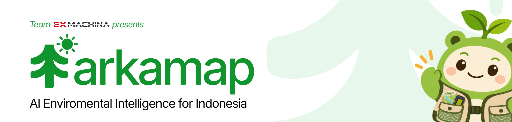
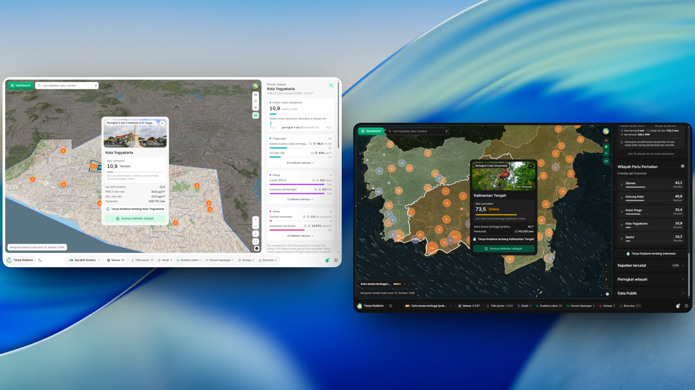
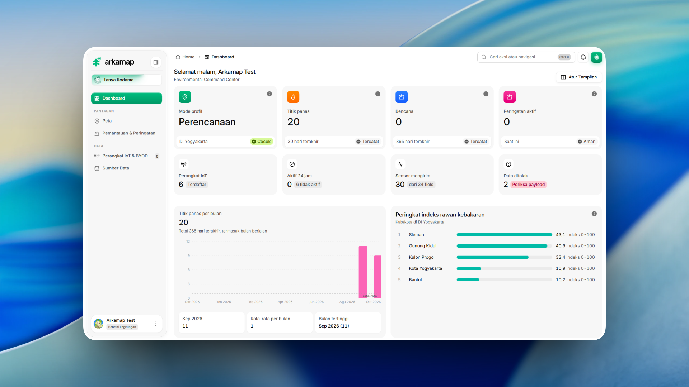
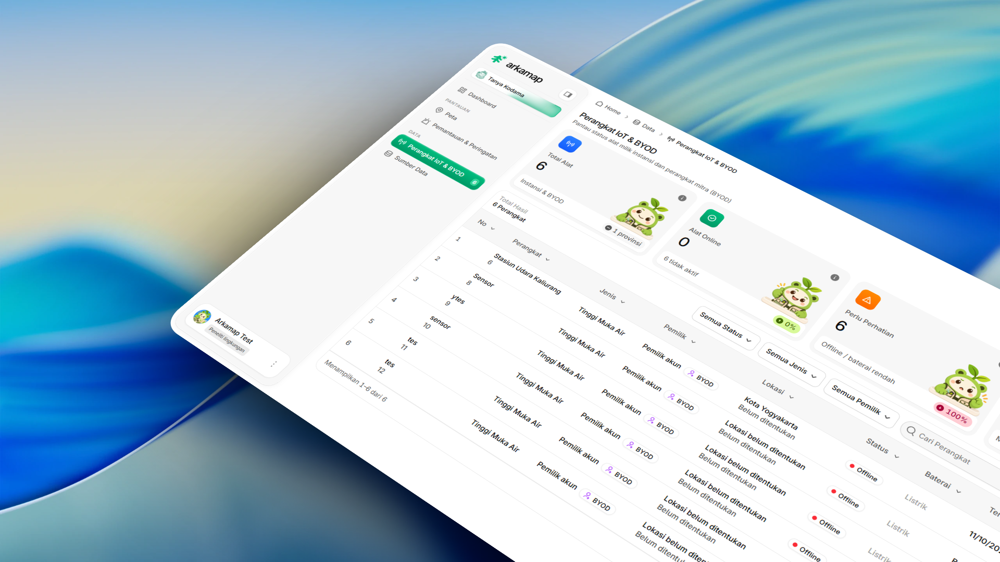
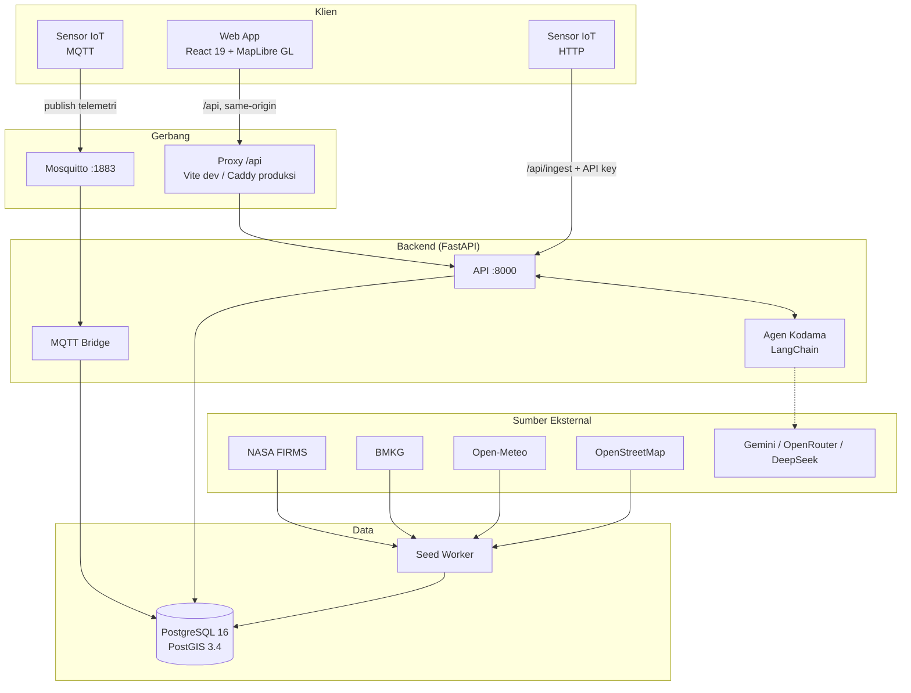
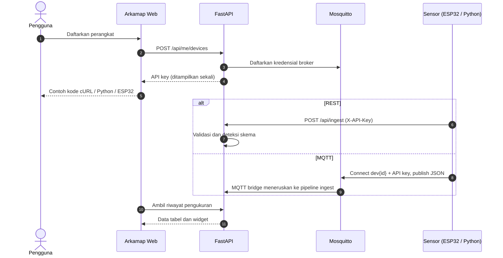

<p align="center">
  
</p>

<h1 align="center">Arkamap</h1>

<p align="center"><strong>Intelijen Lingkungan untuk Indonesia</strong></p>

<p align="center">
  
  
  
  
  
  <a href="LICENSE"></a>
</p>

<table>
  <tr>
    <td width="55%" valign="middle">
      <h3>Peta, Sensor, dan AI dalam Satu Platform</h3>
      <p>Pantau kondisi lingkungan, bandingkan risiko antarwilayah, dan baca pengukuran lapangan bersama Kodama.</p>
      <p>
        <a href="https://arkamap.winatra.app/"></a><br />
        <a href="https://www.youtube.com/watch?v=8o3MS5inVMY"></a>
      </p>
      <p><sub>Ex Machina · JOINTS UGM 2026 · <a href="LICENSE">MIT License</a></sub></p>
    </td>
    <td width="45%" align="center" valign="middle">
      <a href="https://www.youtube.com/watch?v=8o3MS5inVMY"></a>
      <p><a href="https://www.youtube.com/watch?v=8o3MS5inVMY"><strong>Video Demo Arkamap</strong></a></p>
    </td>
  </tr>
</table>

<p align="center">
  <a href="#tentang-arkamap">Tentang</a> ·
  <a href="#fitur-utama">Fitur</a> ·
  <a href="#arsitektur">Arsitektur</a> ·
  <a href="#memulai">Memulai</a> ·
  <a href="#integrasi-sensor-iot-byod">Integrasi IoT</a> ·
  <a href="#pengembangan">Pengembangan</a> ·
  <a href="#dokumentasi">Dokumentasi</a> ·
  <a href="#tim-ex-machina">Tim</a>
</p>

## Tentang Arkamap

Arkamap menghubungkan data lingkungan Indonesia dalam satu ruang kerja berbasis peta. Data publik dan sensor lapangan dibaca bersama untuk memahami kondisi wilayah, menelusuri kejadian, dan mendukung perencanaan.

| Fokus | Di Arkamap |
| :--- | :--- |
| Pantauan wilayah | Peta interaktif berisi titik panas, gempa, peringatan cuaca, dan indikator lingkungan. |
| Data lapangan | Telemetri sensor milik pengguna melalui integrasi IoT dan Bring Your Own Device (BYOD). |
| Analisis | Dashboard, tren historis, dan perbandingan indikator antarwilayah. |
| Asisten AI | Kodama membantu membaca data melalui percakapan, lengkap dengan konteks wilayah dan sumber. |
| Sumber publik | NASA FIRMS, BMKG, Open-Meteo, dan OpenStreetMap. |
| Akses | Peta publik tanpa akun. Profil, dashboard, dan perangkat pribadi tersedia setelah masuk. |

## Fitur Utama

### Peta Geospasial

Kejadian dan indikator lingkungan di seluruh Indonesia, dalam tema terang maupun gelap.

<p align="center">
  <a href="docs/assets/screenshots/peta-geospasial.png"></a>
</p>

| Kemampuan | Detail |
| :--- | :--- |
| Pantauan kejadian | Titik panas NASA FIRMS, gempa BMKG, peringatan cuaca, dan kejadian bencana. |
| Perbandingan wilayah | Layer choropleth dan peringkat indikator cuaca, kualitas udara, serta lingkungan. |
| Konteks spasial | Aliran angin, bangunan 3D pada zoom dekat, dan rincian kejadian langsung dari peta. |
| Sensor lapangan | Pin perangkat berkoordinat milik pengguna setelah masuk. |

### Dashboard Pemantauan

Ringkasan wilayah, tren kejadian, dan kondisi perangkat sesuai profil aktif.

<p align="center">
  <a href="docs/assets/screenshots/dashboard.png"></a>
</p>

| Kemampuan | Detail |
| :--- | :--- |
| Ringkasan wilayah | Titik panas, bencana, peringatan aktif, dan jumlah perangkat IoT. |
| Tren dan prioritas | Grafik kejadian bulanan dan peringkat indikator wilayah. |
| Kesehatan sensor | Perangkat aktif, field yang terbaca, dan kiriman data yang ditolak. |
| Profil pemantauan | Hingga tiga profil, masing-masing dengan wilayah dan fokus perlindungan, respons, atau perencanaan. |

### Perangkat IoT dan BYOD

Hubungkan sensor sendiri, kirim pengukuran, dan kelola riwayatnya dari halaman perangkat.

<p align="center">
  <a href="docs/assets/screenshots/iot-byod.png"></a>
</p>

| Kemampuan | Detail |
| :--- | :--- |
| Integrasi perangkat | REST API dan MQTT, dengan API key tersendiri untuk setiap perangkat. |
| Panduan koneksi | Contoh cURL, Python, dan ESP32 yang siap disalin dari antarmuka. |
| Pengelolaan sensor | Pencarian dan filter berdasarkan status, jenis, serta pemilik. |
| Riwayat pengukuran | Tabel data berversi saat struktur kiriman berubah, serta widget per perangkat. |

### Kodama, Asisten AI Lingkungan

Tanyakan kondisi wilayah, kejadian lingkungan, atau perangkat yang dipantau melalui percakapan.

| Kemampuan | Detail |
| :--- | :--- |
| Konteks data | Menjawab dari data yang tersedia di backend dan menyertakan referensi sumber. |
| Respons bertahap | Jawaban mengalir langsung di antarmuka percakapan. |
| Penyedia model | Gemini, OpenRouter, dan DeepSeek. |
| Mode cadangan | Jawaban berbasis template ketika kunci LLM belum tersedia. |

> [!NOTE]
> Angka pada screenshot mengikuti sesi pengambilan gambar. Saat membaca data, periksa sumber, periode, serta label observasi, prakiraan, atau model. Skor turunan Arkamap adalah alat bantu analisis, bukan peringatan resmi.

## Arsitektur

Frontend menyajikan peta dan dashboard. Backend menangani analisis spasial, agen AI, serta ingest data publik dan sensor. PostGIS menyimpan data geospasial, sedangkan Mosquitto menerima telemetri melalui MQTT.



> [!NOTE]
> Browser mengakses `/api` melalui origin frontend. Vite saat pengembangan dan Caddy saat produksi meneruskan permintaan ke backend sekaligus menambahkan application key di sisi server. Token pengguna disimpan di `sessionStorage`, dan setiap perangkat IoT memakai API key tersendiri. Detailnya ada di [kontrak API](docs/API_CONTRACT.md#autentikasi).

### Struktur Repositori

```text
arkamap/
├── frontend/             React 19, TypeScript, Vite, Tailwind v4, MapLibre GL
│   ├── src/              Komponen UI, peta, panel analitik, dan chat Kodama
│   ├── public/           Aset brand, ikon, dan sprite peta
│   └── scripts/          Cek batas arsitektur dan generator tipe OpenAPI
├── backend/              FastAPI, PostGIS, LangChain
│   ├── app/              Modul API, ingest data publik, IoT, dan agen
│   ├── seed.py           Unduh dataset publik awal
│   └── seed_iot_demo.py  Akun uji dan telemetri IoT contoh
├── docs/                 Kontrak API, panduan backend, frontend, dan integrasi
├── mosquitto/            Konfigurasi broker MQTT dengan autentikasi per perangkat
├── scripts/              Setup database lokal tanpa kontainer (PowerShell)
├── docker-compose.yml    Web, API, database, broker, bridge, dan seed
└── CONTRIBUTING.md       Alur kerja, pull request, dan standar kode
```

Kontrak `docs/backend/openapi.json` diekspor dari kode FastAPI, lalu tipe TypeScript frontend dibangkitkan dari kontrak tersebut. CI menolak pull request bila keduanya tidak sinkron.

## Memulai

### Prasyarat

- Docker dengan Compose v2
- Node.js 22.12 atau lebih baru, hanya untuk dev server frontend (CI memakai Node 24)

### 1. Jalankan dengan Docker

Dari root repositori, nyalakan database, broker, API, MQTT bridge, seed, dan aplikasi web sekaligus:

```bash
docker compose up --build -d
```

Buka [localhost:8080](http://localhost:8080). Service `web` menyajikan build frontend dan meneruskan `/api`, termasuk MQTT WebSocket `ws://localhost:8080/api/mqtt`, ke backend di alamat yang sama, seperti di server produksi.

Untuk database kosong tanpa mengunduh data publik, lewati `seed` dengan `docker compose up --build -d web`. Database, broker, dan API ikut menyala sebagai dependensi.

### 2. Jalankan dev server frontend (opsional)

Untuk mengubah tampilan dengan hot reload:

```bash
cd frontend
npm ci
ARKAMAP_API_TARGET=http://127.0.0.1:8000 npm run dev
```

`ARKAMAP_API_TARGET` juga bisa ditulis di `frontend/.env.local`.

### Alamat service

| Service | Alamat | Keterangan |
| :--- | :--- | :--- |
| Aplikasi web | [localhost:8080](http://localhost:8080) | Build frontend dan `/api` di satu alamat (service `web`) |
| Dev server | [127.0.0.1:5174](http://127.0.0.1:5174) | `npm run dev` dengan hot reload |
| Dokumentasi API | [127.0.0.1:8000/docs](http://127.0.0.1:8000/docs) | Swagger UI untuk menjelajah dan mencoba endpoint |
| Broker MQTT | `localhost:1883` | Ingest sensor dengan user `dev<id>` dan password API key perangkat |
| Evaluator agen | [127.0.0.1:8001](http://127.0.0.1:8001) | Chainlit UI internal, hanya dengan `--profile chat` |

### Data contoh

Saat kontainer pertama kali menyala dengan database kosong, service `seed` mengunduh dataset publik di latar belakang. Aplikasi sudah bisa dipakai selama proses ini berjalan.

Untuk mencoba dashboard sensor tanpa alat fisik, siapkan akun dan perangkat contoh:

```bash
docker compose exec api python seed_iot_demo.py
```

Skrip ini membuat akun `uji.versi@arkamap.local`, perangkat contoh, dan riwayat pengukuran cuaca serta kualitas udara melalui jalur ingest. Kata sandi dicetak saat akun dibuat. Menjalankannya ulang akan mengganti perangkat contoh beserta datanya.

Untuk mencoba agen lewat antarmuka internal:

```bash
docker compose --profile chat up chat
```

## Integrasi Sensor IoT (BYOD)

Daftarkan sensor milik pengguna, komunitas, atau institusi, lalu kirim pengukuran dengan API key perangkat. Halaman perangkat menyediakan URL, payload, dan contoh kode sesuai konfigurasinya.



Contoh pengiriman lewat REST:

```bash
curl -X POST "http://127.0.0.1:8000/api/ingest" \
  -H "Content-Type: application/json" \
  -H "X-API-Key: <DEVICE_API_KEY>" \
  -d '{
    "nama": "cuaca",
    "waktu": "<WAKTU_UKUR_ISO_8601>",
    "data": {
      "suhu": 28.4,
      "kelembapan": 72.1,
      "pm25": 18.5,
      "curah_hujan_mm": 2.0
    }
  }'
```

Ganti `<DEVICE_API_KEY>` dan `<WAKTU_UKUR_ISO_8601>` dengan kunci perangkat dan waktu pengukuran sebenarnya. Field baru pada nama tabel yang sama membentuk versi tabel baru. Format, batas kiriman, dan aturan validasi ada di [aturan kirim data sensor](docs/API_CONTRACT.md#kirim-data-sensor).

## Asisten AI

Kodama aktif penuh setelah kunci penyedia LLM diisi di `.env` pada root repositori:

```env
GEMINI_API_KEY="your-gemini-api-key"
# Alternatif:
# OPENROUTER_API_KEY="your-openrouter-key"
# DEEPSEEK_API_KEY="your-deepseek-key"
```

Contoh pertanyaan:

- Bagaimana tren titik panas di Kalimantan Barat tiga hari terakhir?
- Apa peringatan cuaca BMKG yang berlaku untuk wilayah saya?

Jawaban mengikuti data yang tersedia di backend. Tanpa kunci LLM, backend memakai jawaban cadangan berbasis template. Sebagian modul dan kontrak API masih memakai nama lama agen ini, Jev.

## Pengembangan

### Frontend dengan API hosted

Untuk mengerjakan antarmuka tanpa backend lokal, buat `frontend/.env.hosted.local`:

```env
ARKAMAP_API_TARGET=https://api.arkamap.example.com
ARKAMAP_API_KEY=your-app-key
```

Lalu dari `frontend/`:

```bash
npm run dev:hosted
```

<details>
<summary><strong>Backend tanpa Docker (Windows PowerShell)</strong></summary>

<br />

Butuh Python 3.12 dan PostgreSQL 14+ dengan ekstensi PostGIS.

```powershell
python -m venv .venv
.\.venv\Scripts\python.exe -m pip install -r backend/requirements-dev.txt
powershell -NoProfile -ExecutionPolicy Bypass -File scripts/init-local.ps1
.\.venv\Scripts\python.exe -m uvicorn app.main:app --app-dir backend --env-file .env.local --port 8000
```

</details>

### Pengujian

Jalankan pemeriksaan sesuai bagian yang diubah. Hasil dan batas validasi integrasi dicatat di [dokumen validasi](docs/integration/VALIDATION.md).

```bash
# Backend, dari backend/
python test_iot.py
python test_agent.py
python test_bmkg.py
python test_fire.py
python test_paths.py
python test_responder.py

# Frontend, dari frontend/
npm run check       # lint, typecheck, batas arsitektur, dan katalog UI
npm run build       # build produksi
npm run test:api    # klien API dan streaming agen
npm run api:check   # kesesuaian kontrak OpenAPI dengan tipe TypeScript
```

### Variabel lingkungan

| Variabel | Default Compose | Kegunaan |
| :--- | :--- | :--- |
| `POSTGRES_PASSWORD` | `arkamap` | Kata sandi user database `arkamap`. Wajib diganti untuk rilis publik. |
| `JWT_SECRET` | `local-demo-secret-change-me` | Kunci penandatanganan token JWT. |
| `MQTT_BRIDGE_PASSWORD` | `dev-bridge-password` | Kata sandi internal antara broker dan bridge. |
| `GEMINI_API_KEY` | kosong | Kunci Google Gemini untuk Kodama. |
| `OPENROUTER_API_KEY` | kosong | Kunci OpenRouter, penyedia alternatif. |
| `DEEPSEEK_API_KEY` | kosong | Kunci DeepSeek, penyedia alternatif. |
| `CORS_ORIGINS` | `http://localhost:8080` | Origin yang diizinkan untuk panggilan lintas domain. |

### Batasan saat ini

| Area | Catatan |
| :--- | :--- |
| Data publik | Diambil oleh service seed dan penjadwal backend. Kesegaran data mengikuti sumber, dan layer peta membutuhkan internet. |
| Sesi pengguna | Token disimpan di `sessionStorage` per tab. Sesi bertahan saat refresh, tetapi tab baru perlu masuk ulang. |
| Metadata perangkat | Identitas, kategori, dan koordinat tersimpan di backend. Beberapa isian tambahan di UI masih memakai nilai standar. |
| Modul preview | Simulator, Forensik, dan Disposisi Tugas masih berstatus preview. |

## Dokumentasi

| Area | Panduan |
| :--- | :--- |
| Kontrak API | [Kontrak API](docs/API_CONTRACT.md) · [Matriks Endpoint](docs/integration/API_ENDPOINT_MATRIX.md) · [Audit Kontrak](docs/integration/API_CONTRACT_AUDIT.md) |
| Integrasi | [Panduan Integrasi](docs/integration/README.md) · [Hasil dan Batas Validasi](docs/integration/VALIDATION.md) |
| Backend | [API](docs/backend/API.md) · [Akun dan IoT](docs/backend/IOT.md) · [Pemetaan Endpoint](docs/backend/FRONTEND.md) · [Visualisasi dan Agen](docs/backend/VIZ.md) · [Infrastruktur](docs/backend/Infra.md) |
| Frontend | [Overview](docs/frontend/README.md) · [Arsitektur](docs/frontend/ARCHITECTURE.md) · [Design System](docs/frontend/DESIGN-SYSTEM.md) · [Komponen](docs/frontend/COMPONENTS.md) · [Checklist UI](docs/frontend/UI-CHECKLIST.md) |
| Kontribusi | [Design Guidelines](DESIGN.md) · [Panduan Kontribusi](CONTRIBUTING.md) |
| CI | [Frontend](https://github.com/ex-machina-org/arkamap/actions/workflows/frontend.yml) · [Integrasi dan Backend](https://github.com/ex-machina-org/arkamap/actions/workflows/integration.yml) |

## Tim Ex Machina

Arkamap dikembangkan oleh Ex Machina untuk JOINTS UGM 2026.

| Anggota | Peran | Fokus |
| :--- | :--- | :--- |
| [Mahar](https://github.com/spirinity) | PM, Lead, FE Engineer | Arah produk, pengalaman pengguna, frontend, dan integrasi antarmuka. |
| [Yusma](https://github.com/yusmanata) | ML Engineer | Analisis lingkungan, scoring, dan evaluasi model. |
| [Dicha](https://github.com/user312982) | Backend Engineer | Backend, API, orkestrasi agen AI, dan integrasi data. |
| [Marsa](https://github.com/Amertaa) | IoT Engineer | Sensor, gateway IoT, dan integrasi pengukuran lapangan. |

## Lisensi

[MIT](LICENSE). Copyright 2026 Ex Machina. Komponen turunan BoardUI mengikuti [lisensi aslinya](frontend/LICENSE.boardui).
