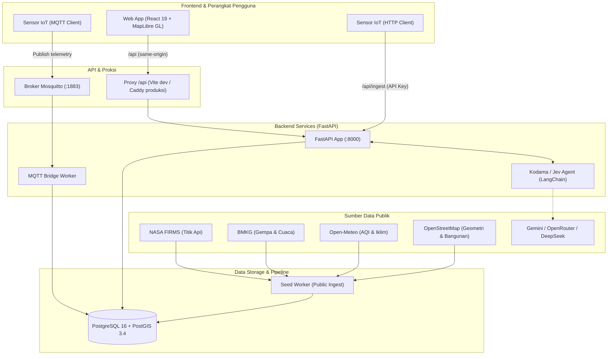
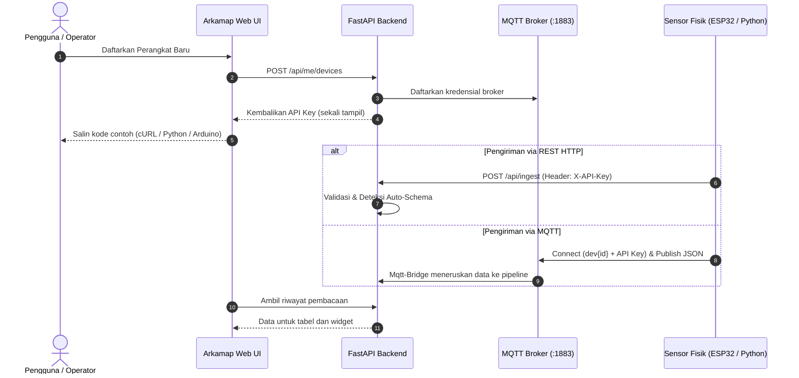

<p align="center">
  
</p>

<h1 align="center">Arkamap</h1>

<p align="center"><strong>Intelijen Lingkungan untuk Indonesia</strong></p>

<table>
  <tr>
    <td width="55%" valign="middle">
      <h3>Peta, Sensor, dan AI dalam Satu Platform</h3>
      <p>Pantau kondisi lingkungan, bandingkan risiko wilayah, dan baca pengukuran lapangan bersama Kodama.</p>
      <p>
        <a href="https://arkamap.winatra.app/"></a><br />
        <a href="https://www.youtube.com/watch?v=8o3MS5inVMY"></a>
      </p>
      <p><sub>Ex Machina · JOINTS UGM 2026 · <a href="LICENSE">MIT License</a></sub></p>
    </td>
    <td width="45%" align="center" valign="middle">
      <a href="https://www.youtube.com/watch?v=8o3MS5inVMY"></a>
      <p><a href="https://www.youtube.com/watch?v=8o3MS5inVMY"><strong>Lihat Arkamap Beraksi</strong></a></p>
    </td>
  </tr>
</table>

<p align="center">
  <a href="#tentang-arkamap">Tentang</a> ·
  <a href="#fitur-utama">Fitur</a> ·
  <a href="#arsitektur-sistem">Arsitektur</a> ·
  <a href="#memulai-cepat">Memulai</a> ·
  <a href="#integrasi-sensor-iot-byod">Integrasi IoT</a> ·
  <a href="#tim-ex-machina">Tim</a> ·
  <a href="#dokumentasi-dan-referensi">Dokumentasi</a>
</p>

## Tentang Arkamap

**Arkamap menghubungkan data lingkungan Indonesia dalam satu ruang kerja berbasis peta.** Data publik dan sensor lapangan dapat dibaca bersama untuk memahami kondisi wilayah, menelusuri kejadian, dan mendukung perencanaan.

| Fokus | Di Arkamap |
| :--- | :--- |
| Pantauan Wilayah | Peta interaktif dengan titik panas, gempa, peringatan cuaca, dan indikator lingkungan. |
| Data Lapangan | Telemetri sensor milik pengguna melalui integrasi IoT dan Bring Your Own Device (BYOD). |
| Analisis | Dashboard, tren historis, dan perbandingan indikator antarwilayah. |
| Asisten AI | Kodama membantu membaca data melalui percakapan dengan konteks wilayah dan sumber. |
| Sumber Publik | NASA FIRMS, BMKG, Open-Meteo, dan OpenStreetMap. |
| Akses | Peta publik tanpa akun; profil, dashboard, dan perangkat pribadi setelah masuk. |

## Fitur Utama

### Peta Geospasial

Baca kejadian dan indikator lingkungan pada peta Indonesia, dalam tema terang maupun gelap.

<p align="center">
  <a href="docs/assets/screenshots/peta-geospasial.png"></a>
</p>

| Kemampuan | Detail |
| :--- | :--- |
| Pantauan Kejadian | Titik panas NASA FIRMS, gempa BMKG, peringatan cuaca, dan kejadian bencana. |
| Perbandingan Wilayah | Layer choropleth dan peringkat indikator cuaca, kualitas udara, serta lingkungan. |
| Konteks Spasial | Aliran angin, bangunan 3D pada zoom dekat, dan rincian kejadian langsung dari peta. |
| Sensor Lapangan | Pin perangkat berkoordinat milik pengguna setelah masuk. |

### Dashboard Pemantauan

Ringkasan wilayah, tren kejadian, dan kondisi perangkat sesuai profil aktif pengguna.

<p align="center">
  <a href="docs/assets/screenshots/dashboard.png"></a>
</p>

| Kemampuan | Detail |
| :--- | :--- |
| Ringkasan Wilayah | Titik panas, bencana, peringatan aktif, dan jumlah perangkat IoT. |
| Tren dan Prioritas | Grafik kejadian bulanan dan peringkat indikator wilayah. |
| Kesehatan Sensor | Perangkat aktif, field yang terbaca, dan kiriman data yang ditolak. |
| Profil Pemantauan | Hingga tiga profil dengan wilayah dan fokus perlindungan, respons, atau perencanaan. |

### Perangkat IoT dan BYOD

Hubungkan sensor sendiri, kirim pengukuran, dan kelola riwayatnya dari halaman perangkat.

<p align="center">
  <a href="docs/assets/screenshots/iot-byod.png"></a>
</p>

| Kemampuan | Detail |
| :--- | :--- |
| Integrasi Perangkat | REST API dan MQTT dengan API key tersendiri untuk setiap perangkat. |
| Panduan Koneksi | Contoh cURL, Python, dan ESP32 yang dapat disalin dari antarmuka. |
| Pengelolaan Sensor | Pencarian dan filter berdasarkan status, jenis, serta pemilik. |
| Riwayat Pengukuran | Tabel data berversi saat struktur kiriman berubah, serta widget per perangkat. |

### Kodama, Asisten AI Lingkungan

Tanyakan kondisi wilayah, kejadian lingkungan, atau perangkat yang dipantau melalui percakapan.

| Kemampuan | Detail |
| :--- | :--- |
| Konteks Data | Menggunakan data yang tersedia di backend dan menyertakan referensi sumber. |
| Respons Bertahap | Jawaban mengalir langsung di antarmuka percakapan. |
| Penyedia Model | Gemini, OpenRouter, dan DeepSeek. |
| Mode Cadangan | Jawaban berbasis template ketika kunci LLM belum tersedia. |
| Modul Teknis | Sebagian modul dan kontrak API masih menggunakan nama Jev. |

> Angka pada screenshot mengikuti sesi pengambilan gambar. Periksa sumber, periode, serta label observasi, prakiraan, atau model saat membaca data. Skor turunan Arkamap merupakan alat bantu analisis, bukan peringatan resmi.

---

## Arsitektur Sistem

Frontend menyajikan peta dan dashboard. Backend menangani analisis spasial, agen AI, serta ingest data publik dan sensor. PostGIS menyimpan data geospasial, sedangkan Mosquitto menerima telemetri melalui MQTT.



> [!NOTE]
> Browser mengakses `/api` melalui origin frontend. Vite saat pengembangan dan Caddy saat produksi meneruskan permintaan ke backend serta menambahkan application key di sisi server. Token pengguna disimpan di `sessionStorage`; setiap perangkat IoT memakai API key tersendiri. Detail akses ada di [kontrak API](docs/API_CONTRACT.md#autentikasi).

---

## Struktur Repositori

```text
arkamap/
├── frontend/                # Antarmuka web (React 19, TypeScript, Vite, Tailwind v4, MapLibre GL)
│   ├── src/                 # Komponen UI, peta interaktif, panel analitik, dan chat Kodama
│   ├── public/              # Aset brand, ikon visual, dan sprite peta
│   └── scripts/             # Pengecekan batas arsitektur & generator tipe OpenAPI
├── backend/                 # API Server & Komputasi Spasial (FastAPI, PostGIS, LangChain)
│   ├── app/                 # Modul API, ingestion data publik, logika IoT, & agen Jev
│   ├── seed.py              # Skrip unduh dataset publik awal (FIRMS, BMKG, Open-Meteo)
│   └── seed_iot_demo.py     # Demo generator untuk akun pengujian dan data telemetri IoT
├── docs/                    # Kontrak API, standar desain UI, & panduan integrasi
│   ├── API_CONTRACT.md      # Rangkuman endpoint dan skema payload per modul
│   ├── frontend/            # Arsitektur UI, katalog komponen, dan checklist UX
│   ├── backend/             # Spesifikasi infrastruktur, IoT, dan panduan API
│   └── assets/              # Aset visual dan banner repositori
├── mosquitto/               # Konfigurasi broker MQTT (otentikasi dinamis per-perangkat)
├── scripts/                 # Otomasi setup database lokal tanpa kontainer (PowerShell)
├── docker-compose.yml       # Orkestrasi kontainer terpadu (API, DB, Broker, Bridge, Seed)
└── CONTRIBUTING.md          # Panduan kontribusi, alur pull request, dan standar kode
```

> [!TIP]
> Kontrak API (`docs/backend/openapi.json`) diekspor langsung dari kode FastAPI backend. Tipe data TypeScript frontend di-*generate* secara deterministik dari kontrak tersebut, dan sistem CI akan menolak pull request apabila ada ketidaksesuaian kontrak antara backend dan frontend.

---

## Memulai Cepat

### Prasyarat

- **Docker** dengan **Compose v2**
- **Node.js** versi `22.12+` atau `24`

### 1. Jalankan Backend dengan Docker

Jalankan seluruh service backend (Database PostGIS, Mosquitto Broker, API, MQTT Bridge, dan Seed Data) dengan satu perintah:

```bash
# Dari root repositori
docker compose up --build -d
```

### 2. Jalankan Frontend

Buka terminal baru untuk memasang dependensi dan menyalakan server frontend:

```bash
cd frontend
npm ci
ARKAMAP_API_TARGET=http://127.0.0.1:8000 npm run dev
```

*(Catatan: Anda juga dapat mendefinisikan `ARKAMAP_API_TARGET=http://127.0.0.1:8000` di dalam file `frontend/.env.local`).*

---

### Port dan Endpoint Service

| Service | Alamat URL / Port | Keterangan |
| :--- | :--- | :--- |
| **Aplikasi Web (Frontend)** | [http://127.0.0.1:5174](http://127.0.0.1:5174) | Peta geospasial, dashboard, dan chat Kodama |
| **Dokumentasi API (Swagger)** | [http://127.0.0.1:8000/docs](http://127.0.0.1:8000/docs) | OpenAPI interactive explorer & testing endpoint |
| **MQTT Broker (Mosquitto)** | `localhost:1883` | Saluran ingest sensor IoT (User: `dev<id>`, Password: API key) |
| **Evaluator agen internal** | [http://127.0.0.1:8001](http://127.0.0.1:8001) | Chainlit UI untuk observabilitas agen (`--profile chat`) |

---

### Data Contoh dan Telemetri Demo

1. **Unduh Data Publik Pertama Kali:** Service `seed` akan otomatis mengunduh dataset nasional pada peluncuran pertama kontainer ke dalam database PostGIS yang kosong. Aplikasi sudah langsung dapat digunakan selama proses ini berlangsung di latar belakang.
2. **Akun & Perangkat Uji IoT:** Untuk mencoba dashboard multi-versi sensor seketika tanpa alat fisik:
   ```bash
   docker compose exec api python seed_iot_demo.py
   ```
   Skrip menyiapkan akun `uji.versi@arkamap.local`, perangkat contoh, dan riwayat pengukuran cuaca serta kualitas udara melalui jalur ingest. Kata sandi akun baru dicetak saat pembuatan. Menjalankannya kembali mengganti perangkat contoh beserta datanya.
3. **Mencoba agen melalui antarmuka internal:**
   ```bash
   docker compose --profile chat up chat
   # Buka http://127.0.0.1:8001 pada peramban Anda
   ```

---

## Integrasi Sensor IoT (BYOD)

Daftarkan sensor lingkungan milik pengguna, komunitas, atau institusi, lalu kirim pengukuran menggunakan API key perangkat. Panduan pada halaman perangkat menyediakan URL, payload, dan contoh kode sesuai konfigurasinya.



### Contoh Pengiriman Telemetri melalui cURL

```bash
curl -X POST "http://127.0.0.1:8000/api/ingest" \
  -H "Content-Type: application/json" \
  -H "X-API-Key: <DEVICE_API_KEY>" \
  -d '{
    "nama": "cuaca",
    "waktu": "<WAKTU_UKUR_ISO_8601>",
    "data": {
      "suhu": 28.4,
      "kelembapan": 72.1,
      "pm25": 18.5,
      "curah_hujan_mm": 2.0
    }
  }'
```

Ganti `<DEVICE_API_KEY>` dan `<WAKTU_UKUR_ISO_8601>` dengan kunci perangkat dan waktu pengukuran aktual. Field baru pada nama tabel yang sama membentuk versi tabel baru. Lihat [aturan kirim data sensor](docs/API_CONTRACT.md#kirim-data-sensor) untuk format, batas kiriman, dan validasi.

---

## Konfigurasi Asisten AI

Untuk mengaktifkan model bahasa Kodama, sediakan kunci penyedia pada `.env` di root repositori:

```env
GEMINI_API_KEY="your-gemini-api-key"
# Penyedia alternatif:
# OPENROUTER_API_KEY="your-openrouter-key"
# DEEPSEEK_API_KEY="your-deepseek-key"
```

Coba pertanyaan seperti *Bagaimana tren titik panas di Kalimantan Barat tiga hari terakhir?* atau *Apa peringatan cuaca BMKG yang tersedia untuk wilayah saya?* Jawaban mengikuti data yang tersedia di backend. Tanpa kunci LLM, backend menggunakan jawaban cadangan berbasis template.

---

## Pengembangan Lokal

### Frontend dengan Hosted API

Bila ingin mengembangkan antarmuka tanpa menyalakan backend lokal, buat file `frontend/.env.hosted.local`:

```env
ARKAMAP_API_TARGET=https://api.arkamap.example.com
ARKAMAP_API_KEY=your-app-key
```

Lalu jalankan server dari direktori `frontend/`:

```bash
npm run dev:hosted
```

### Backend tanpa Docker di Windows PowerShell

Dibutuhkan Python 3.13 dan PostgreSQL 14+ dengan ekstensi PostGIS:

```powershell
python -m venv .venv
.\.venv\Scripts\python.exe -m pip install -r backend/requirements-dev.txt
powershell -NoProfile -ExecutionPolicy Bypass -File scripts/init-local.ps1
.\.venv\Scripts\python.exe -m uvicorn app.main:app --app-dir backend --env-file .env.local --port 8000
```

---

## Pengujian dan Kualitas Kode

Jalankan pemeriksaan berikut sesuai bagian yang diubah. Hasil dan batas validasi integrasi dicatat di [dokumen validasi](docs/integration/VALIDATION.md).

```bash
# 1. Menjalankan rangkaian uji Backend (dari root repositori)
python backend/test_iot.py && python backend/test_agent.py && python backend/test_bmkg.py

# 2. Menjalankan pemeriksaan kualitas Frontend (dari direktori frontend/)
npm run check          # Oxlint linter, TypeScript check, arsitektur boundary, & katalog UI
npm run build          # Verifikasi kesiapan produksi bundle Vite
npm run test:api       # Uji konektivitas klien API dan streaming Jev
npm run api:check      # Validasi kesesuaian kontrak OpenAPI backend & tipe TypeScript frontend
```

---

## Variabel Lingkungan (.env)

| Variabel | Default (Compose Evaluasi) | Deskripsi / Penggunaan Produksi |
| :--- | :--- | :--- |
| `POSTGRES_PASSWORD` | `arkamap` | Kata sandi user database `arkamap` (wajib diubah untuk rilis publik) |
| `JWT_SECRET` | `local-demo-secret-change-me` | Secret key penandatanganan token otentikasi JWT |
| `MQTT_BRIDGE_PASSWORD` | `dev-bridge-password` | Kata sandi internal komunikasi antara broker Mosquitto & bridge |
| `GEMINI_API_KEY` | *(kosong)* | Kunci API Google Gemini untuk mengaktifkan LLM asisten Jev |
| `OPENROUTER_API_KEY` | *(kosong)* | Kunci API penyedia OpenRouter (alternatif LLM Jev) |
| `DEEPSEEK_API_KEY` | *(kosong)* | Kunci API penyedia DeepSeek (alternatif LLM Jev) |
| `CORS_ORIGINS` | `http://localhost:8080` | Daftar origin yang diizinkan untuk panggilan lintas domain |

---

## Batasan dan Catatan Rilis

| Area | Catatan |
| :--- | :--- |
| Data Publik | Data diambil melalui service seed dan penjadwal backend. Kesegaran data mengikuti sumber; layer peta membutuhkan internet. |
| Sesi Pengguna | Token berada di sessionStorage per tab. Sesi bertahan saat refresh; tab baru memerlukan autentikasi ulang. |
| Metadata Perangkat | Identitas, kategori, dan koordinat tersimpan di backend. Beberapa isian tambahan pada UI masih memakai nilai standar. |
| Modul Preview | Simulator, Forensik, dan Disposisi Tugas masih berstatus Preview. |

## Dokumentasi dan Referensi

| Area | Panduan |
| :--- | :--- |
| Kontrak API | [Kontrak API](docs/API_CONTRACT.md) · [Matriks Endpoint](docs/integration/API_ENDPOINT_MATRIX.md) · [Audit Kontrak](docs/integration/API_CONTRACT_AUDIT.md) |
| Integrasi | [Panduan Integrasi](docs/integration/README.md) · [Hasil dan Batas Validasi](docs/integration/VALIDATION.md) |
| Backend | [API](docs/backend/API.md) · [Akun dan IoT](docs/backend/IOT.md) · [Pemetaan Endpoint](docs/backend/FRONTEND.md) · [Visualisasi dan Agen](docs/backend/VIZ.md) · [Infrastruktur](docs/backend/Infra.md) |
| Frontend | [Overview](docs/frontend/README.md) · [Arsitektur](docs/frontend/ARCHITECTURE.md) · [Design System](docs/frontend/DESIGN-SYSTEM.md) · [Komponen](docs/frontend/COMPONENTS.md) · [Checklist UI](docs/frontend/UI-CHECKLIST.md) |
| Kontribusi | [Design Guidelines](DESIGN.md) · [Panduan Kontribusi](CONTRIBUTING.md) |
| Pemeriksaan CI | [Frontend](https://github.com/ex-machina-org/arkamap/actions/workflows/frontend.yml) · [Integrasi dan Backend](https://github.com/ex-machina-org/arkamap/actions/workflows/integration.yml) |

---

## Tim Ex Machina

Arkamap dikembangkan oleh **Ex Machina** untuk **JOINTS UGM 2026**.

| Anggota | Role | Fokus di Arkamap |
| :--- | :--- | :--- |
| [Mahar](https://github.com/spirinity) | PM, Lead, FE Engineer | Arah produk, pengalaman pengguna, frontend, dan integrasi antarmuka. |
| [Yusma](https://github.com/yusmanata) | ML Engineer | Analisis lingkungan, scoring, dan evaluasi hasil model. |
| [Dicha](https://github.com/user312982) | Backend Engineer | Backend, API, orkestrasi agen AI, dan integrasi data. |
| [Marsa](https://github.com/Amertaa) | IoT Engineer | Sensor, gateway IoT, dan integrasi pengukuran lapangan. |

## Lisensi

[MIT](LICENSE). Copyright 2026 Ex Machina. Komponen turunan BoardUI mengikuti [lisensi aslinya](frontend/LICENSE.boardui).
